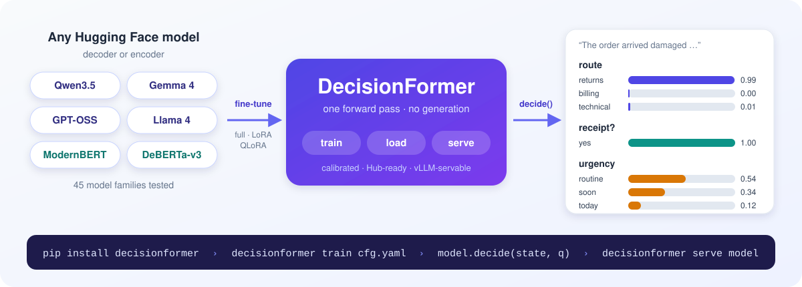

# DecisionFormer



The simplest way to fine-tune and serve decision models on any Hugging Face model. Give it a *state* and typed
*questions*; it returns a calibrated probability for every option in a single forward pass, with no text
generation. Three lines to decide, one command to train, one command to serve.

## Installation

Python 3.10 or newer, with PyTorch 2.6+ and transformers 5.20+.

**With pip**

```bash
pip install decisionformer
pip install "decisionformer[serve]"       # with the API server
```

**From GitHub**

```bash
pip install "git+https://github.com/FrontiersMindAI/decisionformer.git"

# or, to develop
git clone https://github.com/FrontiersMindAI/decisionformer.git
cd decisionformer
pip install -e ".[dev]"
```

Optional extras, combined as `pip install "decisionformer[serve,qlora]"`:

| extra | adds |
|---|---|
| `serve` | the `/v1/systemone` API server (FastAPI, uvicorn) |
| `qlora` | bitsandbytes, for QLoRA |
| `vllm` | the vLLM serving backend (a vLLM build from 2026-10-15 or later) |
| `fla` | fast Gated DeltaNet kernels for Qwen3.5 backbones |
| `data` | datasets, for Hub datasets (`hf:` inputs) and the example converters |

## Quick start

### Inference in Python

```python
from decisionformer import AutoDecisionModel

model = AutoDecisionModel.from_pretrained("vllm-sr/d3-edge")   # or your own fine-tune, local or on the Hub

response = model.decide(
    state="The order arrived damaged yesterday. The customer has a receipt and asks for a replacement today.",
    questions={
        "route": {
            "type": "choice",
            "instructions": "Which team should handle this request?",
            "criteria": {
                "returns": "Refunds, replacements and damaged deliveries",
                "billing": "Payments, invoices and charges",
                "technical": "Product setup and faults",
            },
        },
        "receipt": {
            "type": "noul",
            "instructions": "Does the customer have a receipt?",
        },
        "urgency": {
            "type": "score",
            "instructions": "How urgent is this request?",
            "criteria": ["Routine", "Soon", "Today"],
        },
    },
)
# {
#   "model": "vllm-sr/d3-edge",
#   "answers": {
#     "route": {
#       "type": "choice",
#       "choice": "returns",
#       "probabilities": {"returns": 0.9927, "billing": 0.0001, "technical": 0.0073},
#       "confidence": 0.9602
#     },
#     "receipt": {
#       "type": "noul",
#       "noul": 0.9995
#     },
#     "urgency": {
#       "type": "score",
#       "score": 0.5777,
#       "probabilities": {"0": 0.5393, "1": 0.3438, "2": 0.1169},
#       "confidence": 0.1343,
#       "legend": {"0": "Routine", "1": "Soon", "2": "Today"}
#     }
#   },
#   "usage": {"input_tokens": 345, "output_tokens": 0}
# }
```

`choice` picks one of the `criteria`, `noul` answers yes/no with the probability of yes, and `score` picks one of
2 to 10 ordered levels. `model.decide_many([...])` answers several requests in shared batches.

### Serve as an API

```bash
decisionformer serve vllm-sr/d3-edge --port 8000
```

```bash
curl localhost:8000/v1/systemone -H 'content-type: application/json' -d '{
  "state": "I was charged twice for my subscription this month.",
  "questions": {
    "angry": {"type": "noul", "instructions": "Is the customer angry?"}
  }
}'
```

The server takes the same `state` and `questions` and returns the same JSON as `decide`, with `id`, `object` and
`created` added. It is the System One API used by Jev, vLLM and the Decision Index. Over-long requests are
refused with HTTP 422, never truncated, and `--api-key-env MY_KEY_VAR` requires `Authorization: Bearer <key>`.

For code-readout checkpoints on Qwen3.5 (the Decision 3.0 layout), vLLM can run the model behind the same API.
Other checkpoints fail with a clear error that points to the default backend:

```bash
pip install "decisionformer[vllm]"
decisionformer serve vllm-sr/d3-edge --backend vllm
```

## Supported backbones

Every family below is fine-tuned, exported, reloaded and checked against the Decision Index's response rules in
`tests/test_zoo.py`. Newest first:

| | families |
|---|---|
| **Decoders, hybrid linear attention** | Qwen3.5 (saved whole, with its vision tower), Qwen3-Next |
| **Decoders, mixture of experts** | GPT-OSS, Llama 4, DeepSeek-V3, Qwen3-MoE, Granite-MoE, OLMoE, Phi-MoE, Mixtral |
| **Decoders, dense** | Gemma 4, Gemma 3, Qwen3, SmolLM3, Seed-OSS, EXAONE 4, GLM-4, Ministral, Cohere 2, Hunyuan, OLMo 2, Granite, Phi-3, Qwen2, Gemma 2, Gemma, Mistral, Llama, Phi, StableLM, Falcon, GPT-NeoX, GPT-2 |
| **Encoders** | ModernBERT, EuroBERT, DeBERTa-v3 (and v1/v2), XLM-RoBERTa, RoBERTa, ELECTRA, ALBERT, DistilBERT, BERT, T5 and mT5 (the encoder) |

Decoders read the answer as a code token (`A`, `B`, ...) at the end of the prompt, which works from step 0;
encoders score each option. Encoder-decoder models without a standalone text encoder in transformers (BART) are
refused with a clear error.

## Fine-tune

```bash
decisionformer data split hf:FrontiersMind/deciformer-15k:train --out data/deciformer-15k
decisionformer train configs/recipes/deciformer15k_qwen35.yaml
torchrun --nproc-per-node 8 -m decisionformer train configs/recipes/deciformer15k_qwen35.yaml   # multi-GPU
```

Every setting lives in a YAML config, and any value can be overridden on the command line with dotted keys
(`train.lr=1e-4`). `decisionformer config FILE` prints the resolved configuration. A minimal config:

```yaml
model:
  backbone: Qwen/Qwen3.5-0.8B        # any Hub id or local path
  attention: causal                  # causal | bidirectional | prefix_bidirectional
  head: {type: code_readout}
finetune:
  mode: lora                         # full | lora | qlora | head_only
  lora: {r: 16, lora_alpha: 32, target_modules: all-linear}
data:
  train: data/train.jsonl
  calibration: data/calibration.jsonl
  eval: {dev: data/dev.jsonl}
train:
  output_dir: runs/my-decider
  lr: 2.0e-4
  push_to_hub: my-org/my-decider     # optional: uploads best/ when training ends (private by default)
```

A run writes `runs/<name>/best` and `last`: finished checkpoints in the standard Hugging Face layout, ready for
`from_pretrained`, `serve` and `push`. It also writes `metrics.jsonl`, per-example predictions at every
evaluation, resumable state and `summary.json`.

### Training data

Training data is the request with the gold answers, one JSON object per line. One record, spread out here for
reading:

```json
{
  "id": "t-17",
  "family": "ticket-17",
  "state": {"ticket": 17, "text": "I was charged twice this month."},
  "questions": {
    "route": {
      "type": "choice",
      "criteria": {"billing": "Payments and invoices", "returns": null}
    },
    "angry": {
      "type": "noul",
      "instructions": "Is the customer angry?"
    }
  },
  "gold": {"route": "billing", "angry": false},
  "targets": {"route": {"billing": 0.9, "returns": 0.1}}
}
```

`gold` may also be called `expected` or `answers`. `targets` (soft labels, such as vote shares) and `teachers`
(probabilities to distill from) are optional, per question. A record with a single `question` and a `label` also
works, and so do flat rows with one question each, as the deciformer pipeline writes them: `state`, `question`
(the instructions), `question_type`, `options`, `option_descriptions`, `label` and `soft_target`. `family` keeps
related records together in splits, data checks and bootstrap intervals. Files can be `.jsonl`, `.jsonl.gz`, or a
Hub dataset written as `hf:<name>[:<config>]:<split>`.

`decisionformer data split` holds out 10% for calibration and 10% for dev by default (`--holdout NAME=FRACTION`),
keeping whole families together and each task's share equal in every split; the source is not modified.
`decisionformer data check dev=dev.jsonl calibration=calibration.jsonl train=train.jsonl` finds leakage between
splits.

### Fine-tuning modes

```yaml
finetune:
  mode: qlora
  gradient_checkpointing: true
  quantization: {bits: 4, quant_type: nf4, double_quant: true, compute_dtype: bfloat16}
  lora:                          # passed to peft.LoraConfig with peft's own field names
    r: 16
    lora_alpha: 32
    lora_dropout: 0.05
    target_modules: all-linear   # list | regex | all-linear | attention | mlp | attention_mlp
    use_dora: false
    use_rslora: false
    init_lora_weights: true      # true | gaussian | pissa | olora | loftq | ...
    rank_pattern: {q_proj: 32}
  export: merged                 # merged (default: plain weights, no peft needed) | adapter
```

The LoRA block is checked against peft when the config loads. `all-linear` leaves mixture-of-experts routers
out. The decision head always trains fully, with its own `train.head_lr`. Full fine-tuning also supports
`freeze_embeddings`, `freeze_layers: "0-7"` and `layerwise_lr_decay`. Merged exports keep the base checkpoint's
dtype.

### Heads

| head | what it does | good for |
|---|---|---|
| `code_readout` | Scores the answer codes (`A`, `B`, ... `ZZ`) at the last prompt token, initialized from the LM head | Decoders; up to 255 options; strong from step 0; the standard, servable layout |
| `lm_verbalizer` | The frozen LM head restricted to the codes, with no new parameters | Zero-shot baselines |
| `option_scoring` | Pools each option's own tokens and scores it with a shared MLP | Encoders; any number of options; order-invariant |
| `fixed_softmax` | A classifier over a fixed `labels` list | A fixed label set |
| `binary` | One logit for yes | `noul` questions |
| `ordinal` | A cumulative-link model with increasing thresholds | `score` questions |

Use `model.head` for one task or `model.heads: {task_name: {...}, default: {...}}` for several. A head can set
its own pooler (`decision_token`, `last_token`, `cls`, `mean`, `attention`, `option_spans`).

### Prompts

`data.prompt.style` picks the prompt: `d3` (the default: Decision 3.0's byte-exact prompt, servable by vLLM) or
`autojev` (AutoJev's). Decoders use the tokenizer's own chat template, and `chat_template_kwargs` defaults to
`{enable_thinking: false}`. Register your own format with `decisionformer.register_format`.

### Decoder attention

| `model.attention` | behaviour | saved as |
|---|---|---|
| `causal` (default) | Standard left-to-right attention | `causal` |
| `bidirectional` | Full-attention layers see the whole prompt; recurrent and linear-attention layers (Qwen3.5's Gated DeltaNet) stay causal | `noncausal_full_attention` |
| `prefix_bidirectional` | The prompt is bidirectional and the answer suffix causal | `prefix_bidirectional` |

Bidirectional mode uses transformers' own switches (`is_causal=False` on the text decoder only), so SDPA,
flash and sliding-window kernels all respect it, and a vision tower keeps its own attention. Conformance tests
check every family in `tests/test_attention.py`. Compare against a causal baseline before adopting it: in our
MNLI tests, SmolLM2-360M made bidirectional without adaptation stayed near chance where causal reached 0.80
(`docs/benchmarks.md`).

### Multi-GPU (DDP)

Launch with `torchrun`. NCCL is used on GPUs and gloo on CPU. Every rank computes the same step plan with
balanced token counts. Ranks with fewer micro-batches run zero-weight padding batches, so synchronization never
deadlocks, and the loss is scaled so that DDP averaging yields the global-batch mean (tested against one
process for 1, 2 and 3 ranks). `train.shard_optimizer_states: true` adds ZeRO-1, and `train.save_every` with
`train.resume: auto` resumes exactly, data order and RNG included.

| mode (per 80 GB GPU, approximate) | fits about |
|---|---|
| full, mixed precision | ≤ 3B |
| full + `shard_optimizer_states` on 8 GPUs | 5–7B |
| LoRA (bf16 base) | 14B comfortably, 30B tight |
| QLoRA (4-bit base) | 30B comfortably, 70B tight |

## Evaluate, upload and benchmark

```bash
decisionformer eval runs/my-decider/best data/dev.jsonl --predictions dev.predictions.jsonl
decisionformer predict runs/my-decider/best requests.jsonl --output responses.jsonl
decisionformer compare a.predictions.jsonl b.predictions.jsonl       # paired bootstrap over families
decisionformer push runs/my-decider/best my-org/my-decider            # private unless --public
```

Checkpoints are plain Hugging Face model repos: the backbone's `config.json` and safetensors, the tokenizer,
`decision_config.json`, `readout.safetensors` (or `heads.safetensors` for the other heads) and a model card. In
Python, `model.push_to_hub("my-org/my-decider")` does the same.

`from_pretrained` also loads the other checkpoints of this standard, such as Decision 3.0 (`vllm-sr/d3*`) and
AutoJev exports, with each one's own prompt, attention mode and temperatures. On `vllm-sr/d3-edge` it reproduces
the checkpoint's reference runtime exactly (identical probabilities in BF16, one question per pass).

Run any checkpoint through the [Decision Index](https://huggingface.co/spaces/multimodalart/jev-decision-index)
kit in-process, or serve it and use the kit's `http` engine:

```bash
pip install "decision-index @ git+https://github.com/apolinario/decision-index"
python -m decision_index pipeline --engine decisionformer.integrations.decision_index:DecisionFormerEngine \
    --option model=my-org/my-decider --out runs/index-my-decider
```

## Measured results

On one 8 GB RTX 2060 SUPER in FP16, on MNLI: Qwen3-0.6B with LoRA and `code_readout` went from 0.36 zero-shot to
**0.83** dev accuracy in 250 steps (calibrated ECE 0.042), and Qwen3.5-0.8B with QLoRA and bidirectional attention
reached **0.84** in 150 steps. The vLLM backend matched the transformers backend to within 0.001 per probability, with identical choices,
at a median of 30 ms per 3-question request. Configs and full tables are in [`docs/benchmarks.md`](docs/benchmarks.md).

## Development

```bash
pip install -e ".[dev,data]"
pytest -q                 # offline, tiny random models: about 2 minutes on a laptop CPU
pytest -q -m "not slow"   # unit and attention-conformance tests only
ruff check src tests
```

Experimental: `decisionformer adapt` runs masked next-token prediction (as in LLM2Vec) before bidirectional
training (`configs/recipes/adapt_mntp.yaml`). A short stage did not help in our tests.

## Roadmap

FSDP2 for full fine-tuning beyond the DDP limits, encoding a request's state once for all of its questions,
image and video inputs, and more heads (`multi_label`, `regression`).

## License and acknowledgements

Apache-2.0. The option-code readout, prompt layouts, calibration metrics and near-duplicate checks are adapted
from [AutoJev](https://github.com/denis-pplx/autojev) (MIT; see `NOTICE`). The `d3` prompt and checkpoint
contract follow Decision 3.0 ([`vllm-sr/d3`](https://huggingface.co/vllm-sr/d3)).
